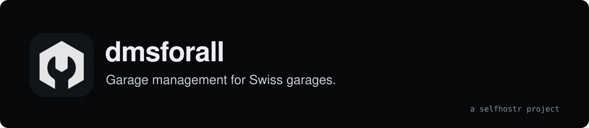

<div align="center">
<a href="https://dmsforall.selfhostr.io"></a>

**Self-hosted management software for Swiss garages and dealerships: repair orders, QR-bill invoices, parts, time clocking and used car sales.**

[Site](https://dmsforall.selfhostr.io) · [Docs](https://dmsforall.selfhostr.io/docs/) · [Demo](https://dmsforall.selfhostr.io/demo/) · [Changelog](CHANGELOG.md)

[](https://github.com/selfhostr/dmsforall/actions/workflows/ci.yml) [](LICENSE)
</div>

## Overview

`dmsforall` runs the workshop and the counter in one browser application: clients, vehicles, repair orders, appointments, time clocking, parts stock, quotes, invoices and payments. It is built for Swiss garages (QR-bill, VAT per line, amounts in whole centimes, French, German and Italian). Free, for good: MIT licence, no paid edition.

## Quick start

```bash
git clone https://github.com/selfhostr/dmsforall.git && cd dmsforall
cp .env.example .env   # optional for a first try on localhost
docker compose up -d
docker compose exec api node dist/cli/creer-garage.js --garage "Garage Exemple" --email direction@example.ch
```

Open http://localhost:8080 and sign in. You need Docker with Compose v2. Set up backups before you enter real data: [Back up and restore](https://dmsforall.selfhostr.io/docs/get-started/backup-and-restore/). For a server with a domain name and HTTPS, see [Install on a server](https://dmsforall.selfhostr.io/docs/get-started/installation/).

## Features

- **Clients and vehicles.** Client records, contacts, vehicle owner history and a global search.
- **Workshop.** Repair orders with labour, parts and fee lines, appointments and a courtesy car list.
- **Time clocking.** Technicians clock their time on repair orders from a shared terminal protected by a PIN.
- **Invoicing.** Quotes, invoices, down-payment invoices and credit notes, with a Swiss QR-bill and PDF output.
- **Payments.** Cash, card, bank transfer, QR-bill, TWINT, compensation and leasing.
- **Parts and stock.** Articles, stock per site, reservations, supplier orders and supplier invoices.
- **Car sales and tyres.** Used and new car sales files, trade-ins, and seasonal tyre storage.
- **Import and export.** Import from a Microsoft Access or dBase/FoxPro archive, WinBIZ accounting export.

## Architecture

A React single-page application built with Vite calls a NestJS API that publishes an OpenAPI description. The API stores data in PostgreSQL 16 through Drizzle ORM, with row-level security on tenant tables. Valkey (Redis-compatible) and BullMQ run background jobs, and Caddy fronts the production Docker stack. More in [ARCHITECTURE.md](ARCHITECTURE.md).

## Limits

- Alpha: the data model, the configuration variables and the screens can still change between releases.
- Designed for Swiss law and VAT only, with French, German and Italian interfaces.
- No tax or legal guarantee: have invoices and accounting exports checked by a fiduciary.
- Connectors to third-party services need their own licences or accounts.
- The operator is responsible for TLS, secrets, backups and updates.

## Contributing

Issues and pull requests are welcome: [CONTRIBUTING.md](CONTRIBUTING.md). Security issues: [SECURITY.md](SECURITY.md).

## License

MIT, see [LICENSE](LICENSE). Provided "as is", without warranty of any kind.

## Support

`dmsforall` is free and has no company behind it. If it saves you time: [sponsor us on GitHub](https://github.com/sponsors/selfhostr).
